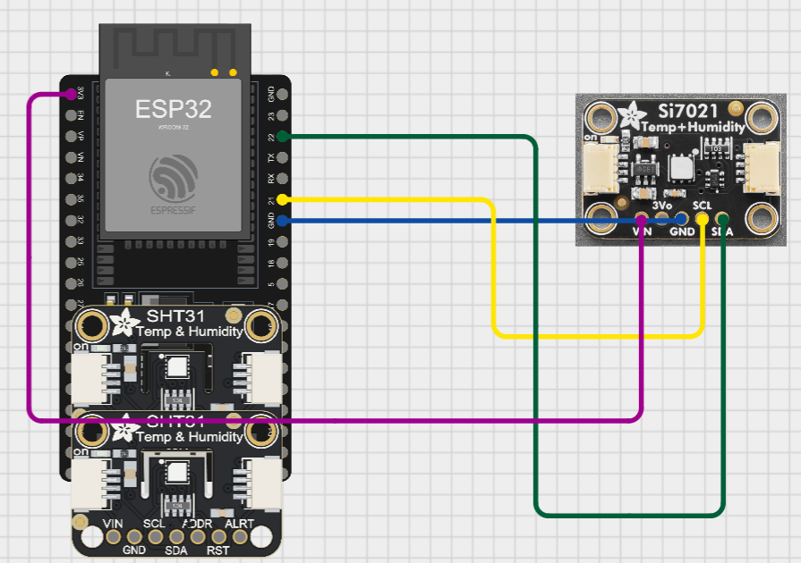
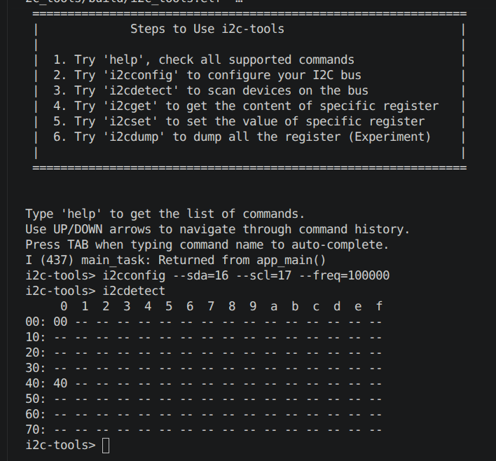
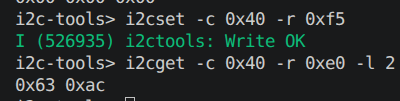
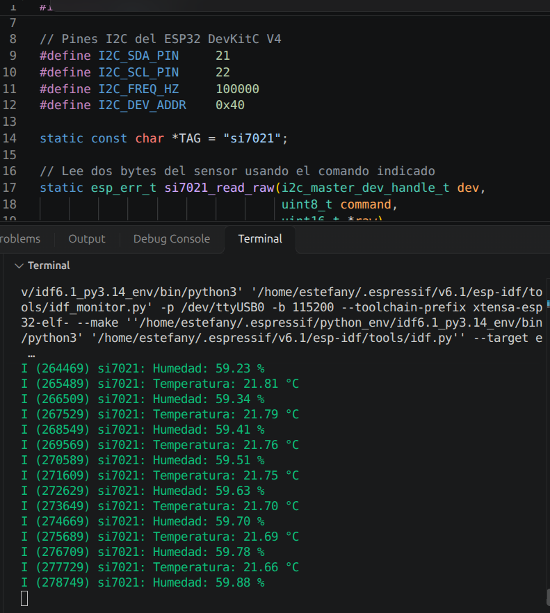
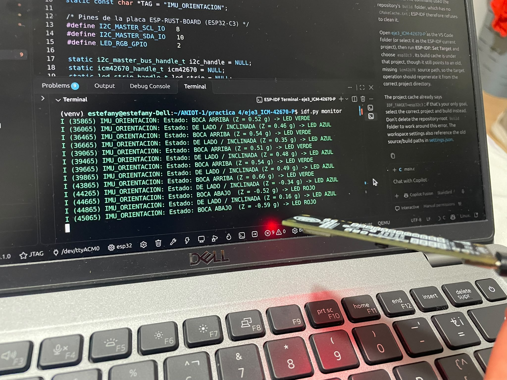
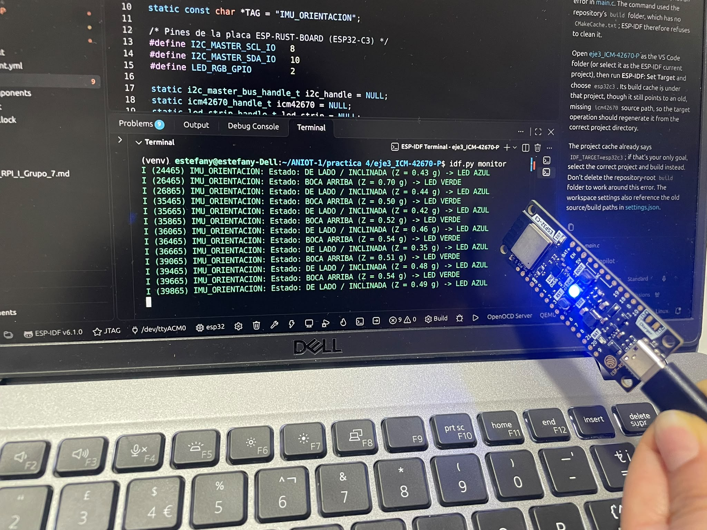
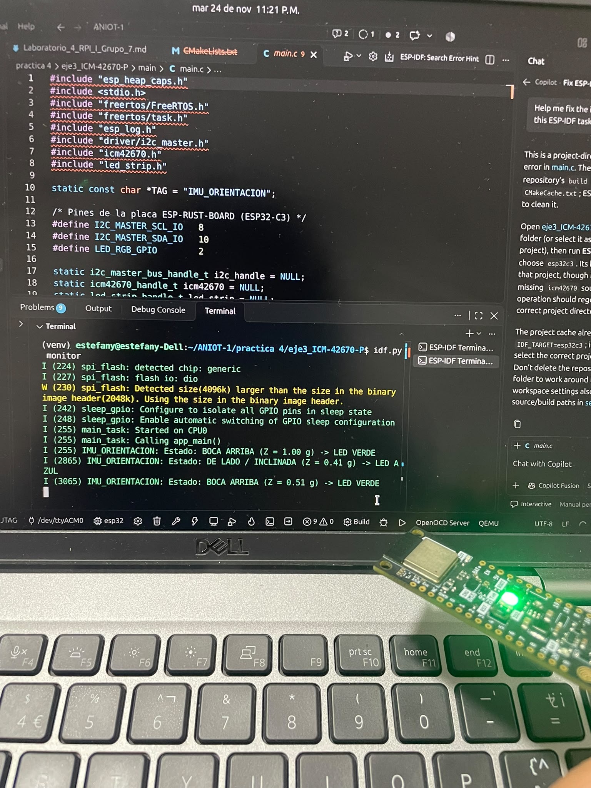

# Laboratorio de ANIOT

Grupo: 7

Integrantes:

- Amirhosein Mozaffari

- Estefania Ruiz

- Sergio Romero Plasencia

Fecha: 23/11/2026

Número de laboratorio: 4

## Desarrollo de ejercicios

### Ejercicio 1

Compila y prueba el ejemplo i2c_tools de la carpeta de ejemplos (examples/peripherals/i2c/i2c_tools). Conecta el sensor a los pines indicados por defecto (también a Vcc y a tierra) y ejecuta al comando i2cdetect. Prueba a los distintos comandos disponibles para tratar de leer información del sensor.


<div align="center">



*Imagen 1 Conexión del ESP32 y sensor Si7021*

</div>


<div align="center">



*Escaneo y conexión con el dispositivo*

</div>

Se ejecuta en la imagen 2 el menu de ayuda de I2C, tenemos tambien la configuración del bus I2C: 
Se ejecuta el comando i2cconfig --sda=16 --scl=17 --freq=100000, que asigna el pin GPIO 16 para datos (SDA), el GPIO 17 para el reloj (SCL) y establece una frecuencia de 100 kHz.   
Escaneo de dispositivos (i2cdetect): Se muestra una tabla hexadecimal de direcciones I2C (de 0x00 a 0x7f) donde se detectan dos respuestas:   
00: La dirección general de llamada (General Call) del protocolo I2C.   
40: Un dispositivo esclavo conectado y respondiendo en la dirección hexadecimal 0x40 

<div align="center">



*Respuesta a la escritura y consulta*

</div>


La captura muestra dos operaciones consecutivas de escritura y lectura en la consola i2c-tools sobre el dispositivo ubicado en la dirección 0x40 típico del sensor Si7021:   
1.- Envío de comando 
 	-- (i2cset):i2cset -c 0x40 -r 0xf5 envía el byte de comando 0xf5 al dispositivo 0x40 (en sensores como el Si7021, 0xF5 corresponde a iniciar una medición de humedad relativa en modo No Hold Master).   
 	-- I (526935) i2ctools: Write OK (en verde) confirma que el dispositivo reconoció el comando correctamente.   
 2.- Lectura de resultado 
 	--(i2cget):i2cget -c 0x40 -r 0xe0 -l 2 lee 2 bytes (-l 2) desde el registro 0xe0 del dispositivo 0x40 (en el Si7021, 0xE0 lee el valor de temperatura medido previamente durante la conversión de humedad).   
	--0x63 0xac son los dos bytes hexadecimales devueltos por el sensor como respuesta. 

# Cálculo de Temperatura desde Lectura I2C (Si7021 / HTU21D)

## 1. Datos obtenidos del bus I2C
* **Dirección del dispositivo:** `0x40`[cite: 3]
* **Comando de lectura de temperatura previa:** `0xe0`[cite: 3]
* **Bytes leídos (`MSB` y `LSB`):** `0x63 0xac`[cite: 3]

---

## 2. Conversión a valor crudo (`Raw_Temp`)
Se combinan los dos bytes recibidos en un entero sin signo de 16 bits (`uint16_t`), desplazando el byte más significativo (`0x63`) 8 bits a la izquierda y aplicando una operación `OR` con el byte menos significativo (`0xac`)[cite: 3]:

$$
\text{Raw\_Temp} = (\text{0x63} \ll 8) \mid \text{0xac} = \text{0x63ac}
$$


Conversión a decimal:

$$
\text{Raw\_Temp} = (99 \times 256) + 172 = 25344 + 172 = 25516
$$

---

## 3. Aplicación de la fórmula de temperatura
Fórmula proporcionada[cite: 4]:

$$\text{Temperature (}^\circ\text{C)} = \frac{175.72 \times \text{Raw\_Temp}}{65536.0} - 46.85$$

Sustituyendo `Raw_Temp = 25516`:

$$\text{Temperature (}^\circ\text{C)} = \frac{175.72 \times 25516}{65536.0} - 46.85$$

$$\text{Temperature (}^\circ\text{C)} = \frac{4483671.52}{65536.0} - 46.85$$

$$\text{Temperature (}^\circ\text{C)} \approx 68.4154 - 46.85 = \mathbf{21.5654\,^\circ\text{C}}$$

---

## 4. Implementación equivalente en C (ESP-IDF)

```c
uint8_t raw_data[2] = {0x63, 0xac}; // Bytes leídos del registro 0xe0[cite: 3]
uint16_t raw_temp = ((uint16_t)raw_data[0] << 8) | raw_data[1];
float temperature = ((175.72f * (float)raw_temp) / 65536.0f) - 46.85f; // 21.57 °C[cite: 4]5654^\circ\text{C}$$  
```

### Ejercicio 2

Ejercicios obligatorios
Usar sensor Si7021 en ESP32 devkit-c

Escribe un código que monitorice la temperatura leyendo el sensor Si7021 conectado al ESP32 devkit-c v4 (placa antigua). Utiliza el nuevo driver para realizar la implementación. Para ello puedes seguir el siguiente template:


<div align="center">


*Imagen 4 Respuesta del sensor con la temperatura y humedad*

</div>


### Ejercicio 2 Usar componente ICM-42670-P con nuevo driver


<div align="center">



*Imagen 5 Medición de temperatura y humedad*

En la imagen 5 se puede visualizar en el monitor de visual studio los valores tomados con el sensor de humedad y temperatura 

</div>


###  Ejercicio 3 Usar componente ICM-42670-P con nuevo driver

El registro de componentes de IDF incluye un componente para utilizar la IMU incluida en la placa ESP-RUST-BOARD (con el SoC ESP32-C3):ICM42607/ICM42670 6-Axis MotionTracking (Accelerometer and Gyroscope).

Crea una aplicación que monitorice el estado del acelerómetro y determine si la placa está boca arriba o boca abajo. El LED RGB cambiará de color en función de la orientación, y se imprimirá por terminal el estado actual.

Recuerda que, antes de poder usar cualquier dispositivo I2C, es necesario instanciar el controlador de bus I2C que vayamos a utilizar (en este caso, el úinico disponible en esta placa).

<div align="center">



*Lista de atributos de GATT*

</div>


<div align="center">



*Lista de atributos de GATT*

</div>

<div align="center">



*Lista de atributos de GATT*

</div>


## Cuestiones

1. ¿Qué dirección tiene el dispositivo I2C?

La dirección I2C en mi caso es 0x40 que se obtuvo con el comando i2cdetect

2. ¿Qué llamada de ESP-IDF utiliza el código para determinar el device ID? ¿Qué comando se envía?

    Llamada de ESP-IDF (driver I2C):

        En el driver tradicional (driver/i2c.h): i2c_master_write_read_device() (o una secuencia con i2c_master_cmd_begin()).

        En el driver nuevo (driver/i2c_master.h de ESP-IDF v5+): i2c_master_transmit_receive().(A nivel de la librería del sensor, esta operación está encapsulada dentro de icm42670_get_deviceid()).

    Comando (dirección de registro) enviado: Se envía 0x75, que corresponde al registro WHO_AM_I del ICM-42670-P (el sensor responde con el byte 0x67 para identificarse).

3. Transacciones en el bus I2C al llamar a icm42670_acce_set_pwr(icm42670, ACCE_PWR_LOWNOISE);

Para activar el acelerómetro en modo Low Noise, la función realiza una operación de lectura-modificación-escritura sobre el registro PWR_MGMT0 (dirección 0x1F) para poner los bits ACCEL_MODE (bits 1:0) a 11 (0x03) sin alterar el estado del giroscopio ni del sensor de temperatura:
Plaintext

START | 0x68 WR | ACK | 0x1F | ACK | START (Repeated) | 0x68 RD | ACK | <valor_actual_PWR_MGMT0> | NACK | STOP | START | 0x68 WR | ACK | 0x1F | ACK | <valor_actual | 0x03> | ACK | STOP

(Nota: Si el giroscopio estaba apagado, <valor_actual_PWR_MGMT0> suele ser 0x00, por lo que el byte escrito en la segunda transacción es 0x03).
4. ¿Qué comando se utiliza para leer el valor en crudo (raw) del acelerómetro?

Se envía la dirección inicial del primer registro de datos del acelerómetro: 0x0B, que corresponde al registro ACCEL_DATA_X1 (byte alto del eje X). Gracias al autoincremento interno de registros del ICM-42670-P, basta con apuntar a 0x0B para leer los tres ejes de forma consecutiva.
5. ¿Cuántos bytes se leen tras enviar el comando de lectura de acelerómetro raw? ¿A qué se corresponde cada byte?

Se leen 6 bytes consecutivos (2 bytes —16 bits en complemento a dos, formato Big Endian— por cada uno de los 3 ejes):
Orden	Registro	Nombre	Correspondencia
Byte 0	0x0B	ACCEL_DATA_X1	Eje X — Byte más significativo (MSB, bits [15:8])
Byte 1	0x0C	ACCEL_DATA_X0	Eje X — Byte menos significativo (LSB, bits [7:0])
Byte 2	0x0D	ACCEL_DATA_Y1	Eje Y — Byte más significativo (MSB, bits [15:8])
Byte 3	0x0E	ACCEL_DATA_Y0	Eje Y — Byte menos significativo (LSB, bits [7:0])
Byte 4	0x0F	ACCEL_DATA_Z1	Eje Z — Byte más significativo (MSB, bits [15:8])
Byte 5	0x10	ACCEL_DATA_Z0	Eje Z — Byte menos significativo (LSB, bits [7:0])
